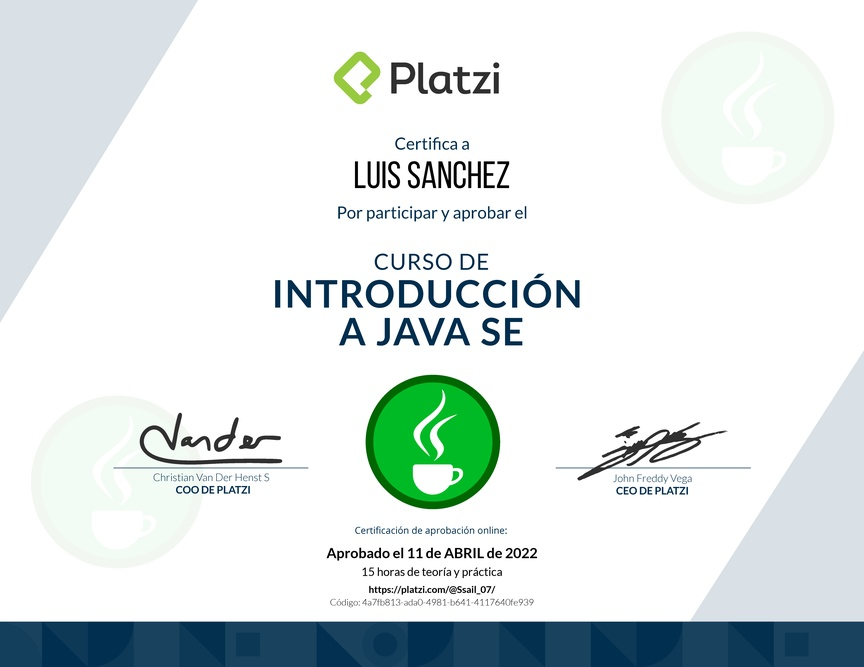

# Curso de Introducción a Java SE ☕

  
  

---

## 🧠 Contenido

Introducción a los fundamentos de Java SE, sintaxis básica y primeros conceptos del lenguaje.

* 📜 [Certificado 2022](diploma-introduccion-java-se-basico.pdf "Diploma 2022")

## 📂 Índice

  <a href="../../../README.md">🔝 Índice principal</a>

- [Manual V1.0 Introducción a Java SE](Curso%20de%20Introduccion%20a%20JAVA%20SE.%20v2.pdf "Manual V1.0 Introducción a Java SE")

  

---

  <a href="../../../README.md"> 🔝 <b>Indice Principal</b> 🔝 </a>

---