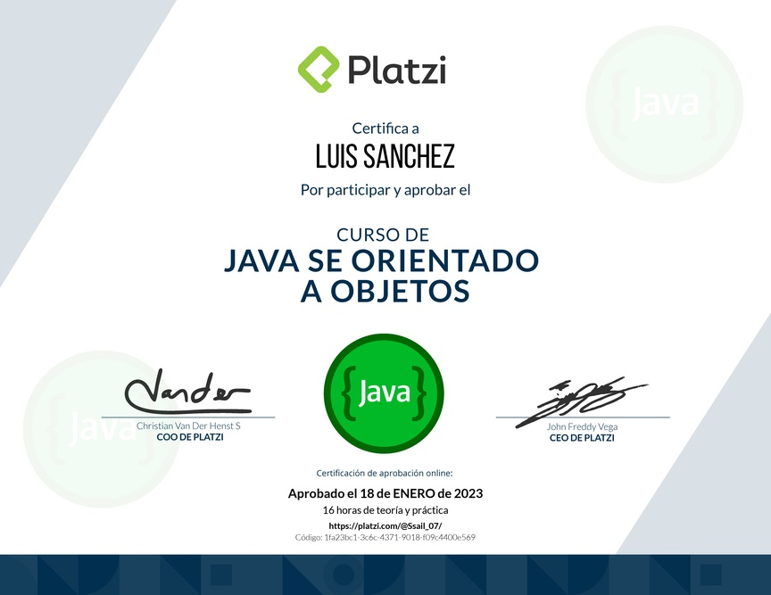

# Curso de Java SE POO ⚙️

  
  

---

## 🧠 Contenido

Aplicación práctica de la programación orientada a objetos utilizando Java SE.

* 📜 [Diploma Java SE POO 2023](diploma-java-se-poo.pdf "Diploma Java SE POO 2023")

## 📂 Índice

  <a href="../../../README.md">🔝 Índice principal</a>

- [Manual V1.0 Java SE POO](Java%20SE%20POO.pdf "Manual V1.0 Java SE POO")

  

---

  <a href="../../../README.md"> 🔝 <b>Indice Principal</b> 🔝 </a>

---