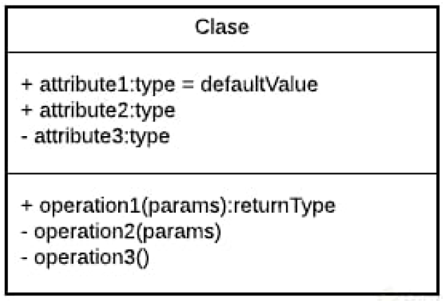
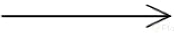
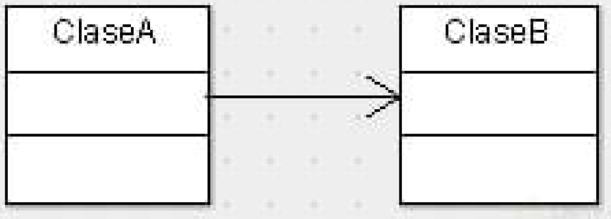
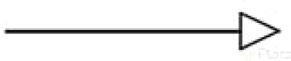
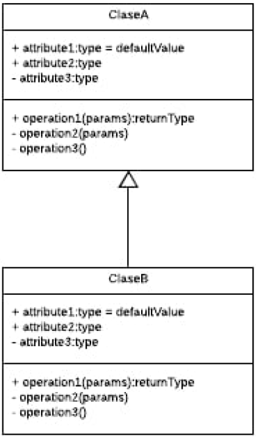
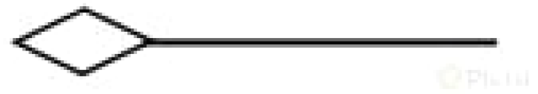
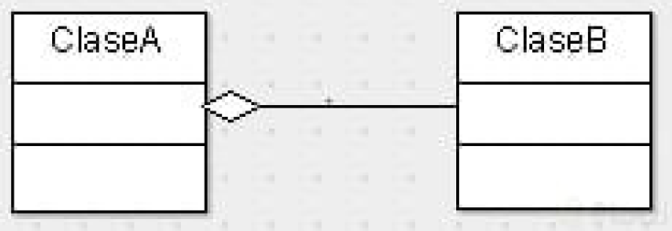
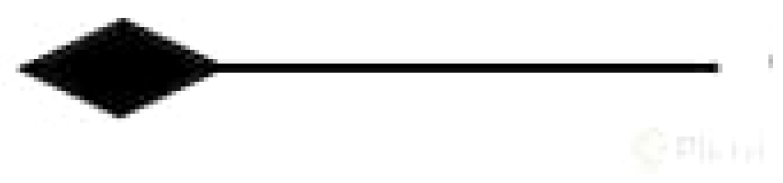
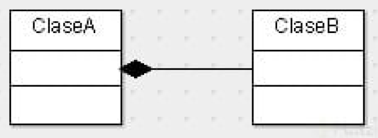

# 🧱 Diagramas de modelado UML

## 📌 ¿Qué es UML?

UML (Unified Modeling Language) es una forma **gráfica** de representar:

- Estructura del sistema  
- Comportamiento  
- Relaciones entre objetos  

> 💡 Es como un “mapa visual” antes de programar.

### 📊 (OMT → UML)

> ⚠️ OMT está descontinuado, pero sentó las bases de UML.

#### 🏛️ Contexto histórico

- **OMT (1991)**: Metodología de modelado orientado a objetos  
- **UML (1997)**: Evolución de OMT, se convierte en estándar  

> 🧠 UML es el lenguaje estándar para representar sistemas de software de forma visual.

---

## 🧱 Estructura de una Clase en UML

Una clase se representa con 3 secciones:

| 🧱 Componentes | 📊 Representación |
|-------------------------------|------------------|
| - Nombre de la clase   ---------------------------------------   - Atributos (propiedades)   ---------------------------------------   - Métodos (operaciones) |  |

### 🔐 Visibilidad

| Símbolo | Acceso     | ¿Para qué sirve? |
|:--------:|------------|------------------|
| +      | public     | Accesible desde cualquier parte. Se usa cuando quieres que otras clases interactúen directamente con este atributo o método (interfaces públicas). |
| -      | private    | Solo accesible dentro de la misma clase. Se usa para proteger datos internos y aplicar encapsulamiento. |
| #      | protected  | Accesible dentro de la misma clase y sus subclases (herencia). Permite extender comportamiento sin exponerlo completamente. |
| ~      | default    | Accesible solo dentro del mismo paquete. Se usa para compartir entre clases relacionadas sin hacerlo público. |

#### 🧠 Explicación rápida (nivel ingeniería)

En codigo profecional:

- private → control total
  - 👉 Evita que rompan tu lógica interna
  - ✅ la mayoría debería ser private
- protected → extensión controlada
  - Permite herencia sin abrir todo
- default → colaboración local
  - Ideal para módulos internos
  - ⚖️ protected y default son herramientas de diseño
- public → contrato externo
  -  Lo que expones al mundo
  - ❌ casi nunca todo es public

---

## 🔗 Relaciones en UML

### 1. Asociación

Relación básica entre clases donde **una conoce o usa a la otra**, pero no depende fuertemente de su existencia.

🔥 Regla de oro  
**Asociación = “usa un” (has-a / uses-a)** ← Usa este metodo para validar si tiene sentido.  
`Usuario` usa un `Carrito`.

**Ejemplo real:**  
Una clase `Usuario` usa una clase `Carrito`.  

`Carro` usa un `Motor`  

🔥 A `Carro` --> B `Motor`   

pero `Motor` podría existir sin `Carro`  
y `Carro` podría cambiar de `motor`  

**Cuándo usarlo:**

- Cuando una clase necesita interactuar con otra
- Cuando hay referencia pero no dependencia fuerte
- Usa sus metodos

**Idea clave:**  
“A usa a B, pero no depende totalmente de B”

| 🔗 Tipo | 🧱 Ejemplo visual |
|--------|------------------|
|  |  |

> La flecha indica dirección de conocimiento (quién usa a quién), no propiedad.
---

### 2. Herencia

△ Relación padre-hijo **hereda atributos y métodos de otra**.

👉 Reutiliza todo el código  

🔥 Regla de oro  
Modela una relación de tipo **“es un” (is-a)**

**Ejemplo real:**  

Una clase `Perro` hereda de `Animal`.  

✅ `Perro` **es un** `Animal` → ✔️ Herencia válida  

Perro → Animal

El perro es un animal, por lo tanto comparte sus características base.  

❌ `Carro` **es un** `Motor` → ❌ No tiene sentido

**Cuándo usarlo:**

* Cuando una clase es una especialización de otra
* Cuando quieres reutilizar comportamiento común
* Cuando existe una relación clara de jerarquía

| 🔗 Tipo | 🧱 Ejemplo visual |
|--------|------------------|
|  |  |

> La flecha apunta del hijo al padre (quién hereda de quién).

### 🧠 Cómo diferenciar Herencia de asociación rapidamente?

| Relación   | Pregunta mental        |
| ---------- | ---------------------- |
| Herencia   | ¿Es un? (is-a)         |
| Asociación | ¿Tiene/usa un? (has-a, uses-a) |

---

### 3. Agregación (◊)

Relación donde una clase **tiene a otra como parte**, pero esta **puede existir de forma independiente** (Relación débil).

👉 Representa una relación de tipo “tiene un” (has-a)  
👉 Es una forma más estructurada de asociación  

**Ejemplo real:**  
Un `Equipo` tiene `Jugadores`, pero los jugadores pueden existir sin el equipo.

Equipo ◊---- Jugador

**Cuándo usarlo:**

- Cuando hay una relación contenedor–contenido o todo–parte
- Cuando las partes pueden existir sin el todo  
- Cuando los objetos pueden compartirse  

**Idea clave:**  
“A tiene a B, pero B puede vivir sin A”

| 🔗 Tipo | 🧱 Ejemplo visual |
|--------|------------------|
|  |  |

> El rombo va en el objeto contenedor (el “todo”) y apunta hacia la parte.

---

### 4. Composición (◆)

Relación donde una clase **contiene a otra y controla completamente su existencia** (dependencia total) .

👉 Es una relación de tipo **“tiene un” (has-a) fuerte**  
👉 Representa una dependencia total

- Un objeto NO puede existir sin el otro  

🧠 **Ejemplo:**

- Tree → contiene → Leaf  
- Si muere Tree → mueren sus hojas  

⚖️ Diferencia clave

| Tipo | Dependencia | Vida independiente |
|------|------------|-------------------|
| Agregación | Débil | ✅ Sí |
| Composición | Fuerte | ❌ No |

* Agregación → “pueden separarse”
* Composición → “mueren juntos”

**Cuándo usarlo:**

* Cuando la parte **no puede existir sin el todo**
* Cuando el objeto es creado y destruido por el contenedor
* Cuando hay dependencia fuerte de ciclo de vida

---

**Idea clave:**
“A tiene a B, y B no puede vivir sin A”

---

| 🔗 Tipo                                                                       | 🧱 Ejemplo visual                                                              |
| ----------------------------------------------------------------------------- | ------------------------------------------------------------------------------ |
|  |  |

> El rombo sólido indica dependencia fuerte. Va en el objeto contenedor (el “todo”).

---
