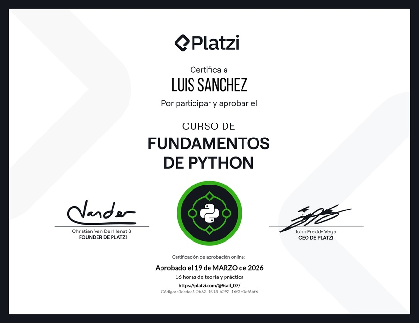

# 🐍 Fundamentos de Python

## 📖 Descripción

Este directorio reúne mis apuntes, ejercicios y prácticas desarrollados durante el **Curso de Fundamentos de Python de Platzi**.

Realicé este curso con el propósito de reforzar mis conocimientos del lenguaje, profundizar en algunas de sus características y poner en práctica los conceptos mediante pequeños programas.

También cuento con apuntes más extensos de Python en mi repositorio [CoursesDaltoDevLab](https://github.com/Ssail-1/CoursesDaltoDevLab/tree/main/Python/Curso-python-desde-cero/Notes).

## 📂 Índice de contenidos

### Conceptos y ejercicios

| Tema | Material |
|---|---|
| Conversión a booleanos | [Código Python](1-Clase-datos-bool.py) |
| Módulo `random` | [Código Python](2-Clase-random.py) |
| Operador Walrus `:=` | [Código Python](3-Operador-Warlus.py) |
| Sentencia `match` | [Apuntes](4-Sentencia_Match.md) |
| Patrones avanzados de `match` | [Apuntes](4.1-Patrones-avanzados-match.md) |
| Patrones útiles de `match` | [Apuntes](4.2-Patrones-utiles-de-match.md) |
| `match` vs. diccionarios de funciones | [Apuntes](4.3-Match-vs-diccionario-de-funciones.md) |
| Manejo de errores y excepciones | [Código Python](5-Manejo-de-errores.py) |
| Lectura y escritura de archivos | [Código Python](6-Lectura-escritura-de-archivos.py) |

## ☕ Práctica final: Máquina de café

Como ejercicio de aplicación, desarrollé un pequeño programa de consola que simula una máquina de café.

El proyecto está organizado en distintos módulos para practicar la separación de responsabilidades, el procesamiento de pedidos y el manejo de un historial.

**Explorar el proyecto:** [Máquina de café](Trabajo-final-maquina-de-cafe/README.md)

### Cómo ejecutar la práctica

Con Python 3 instalado, desde la raíz del repositorio:

1. Accede al directorio `Courses/TechSkills/python/fundamentos-de-python/Trabajo-final-maquina-de-cafe`.
2. Ejecuta `python3 main.py`.
3. Sigue las instrucciones que muestra el programa en la terminal.

## 🎓 Certificación

Curso realizado en Platzi durante 2026.

📜 [Consultar certificado](diploma-fundamentos-python.pdf)

---

**Créditos:** Apuntes, ejercicios y práctica elaborados como parte de mi formación personal, tomando como referencia el curso de [Platzi](https://platzi.com/).

[⬆️ Volver al índice principal de PlatziNotes](../../../../README.md)